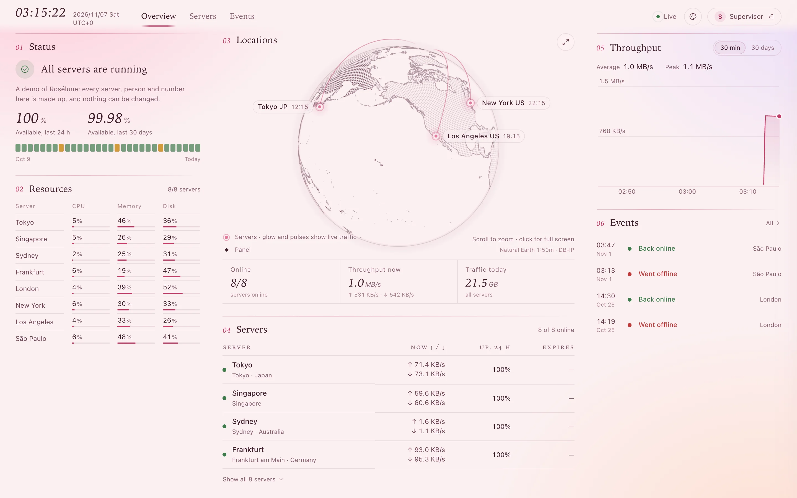
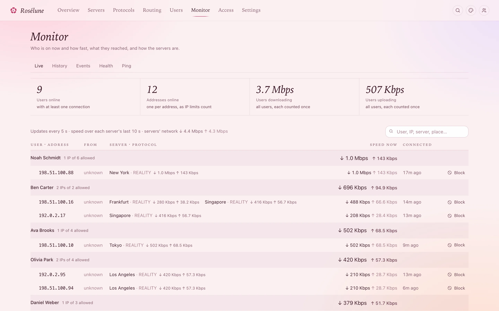
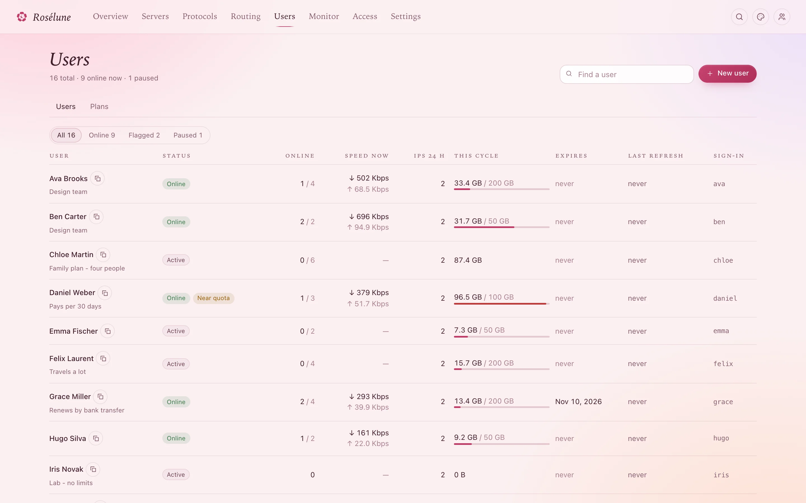
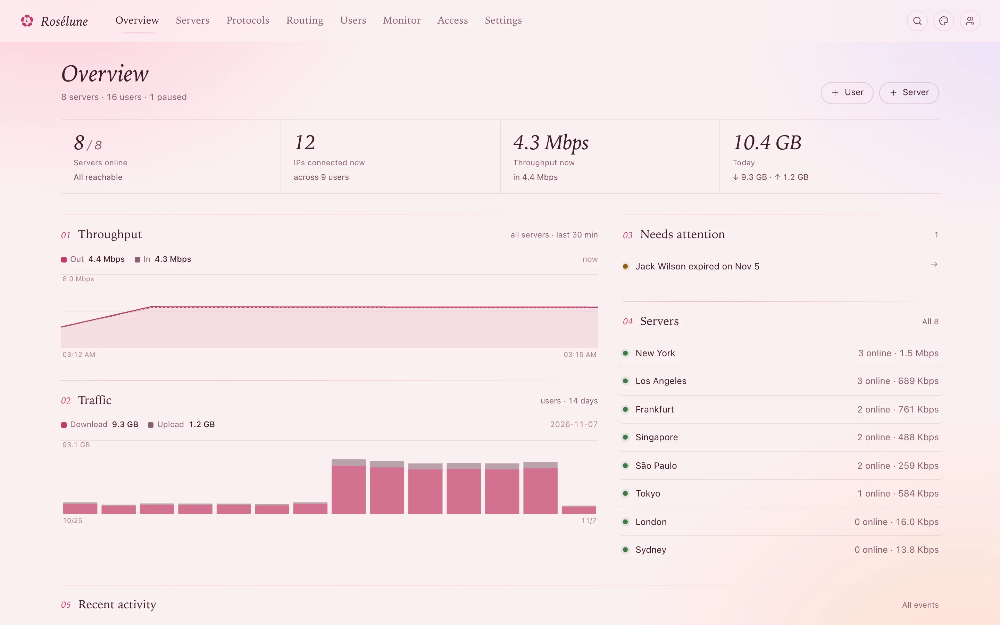
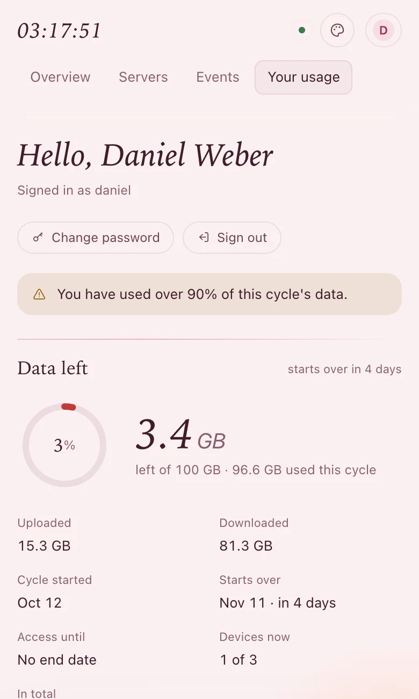
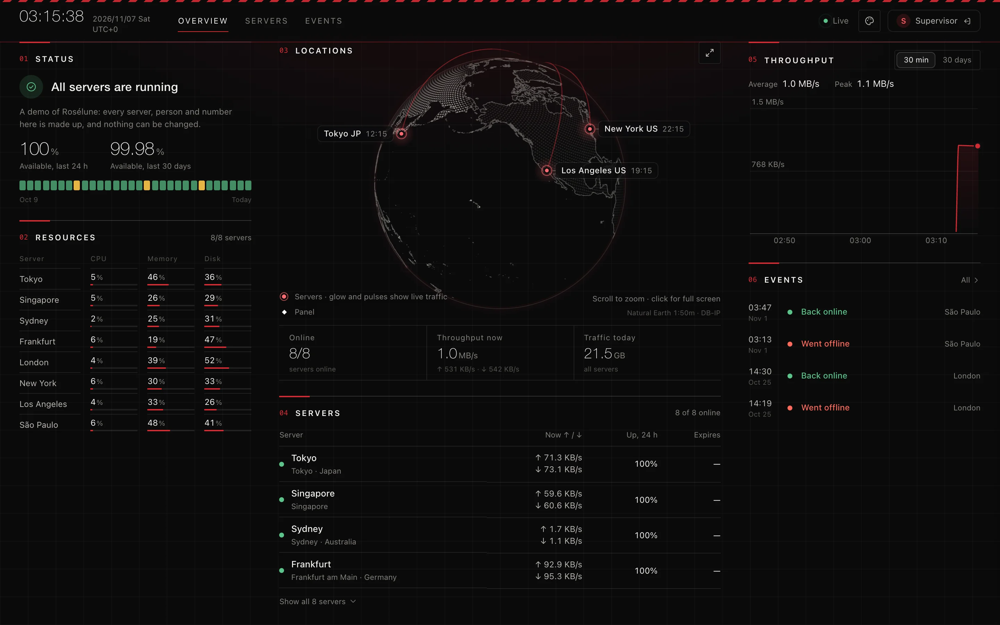
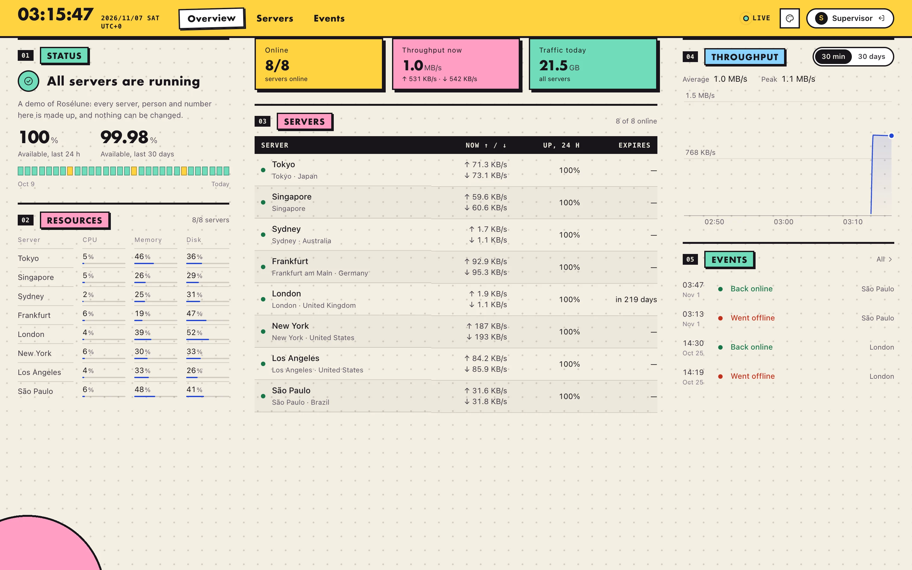
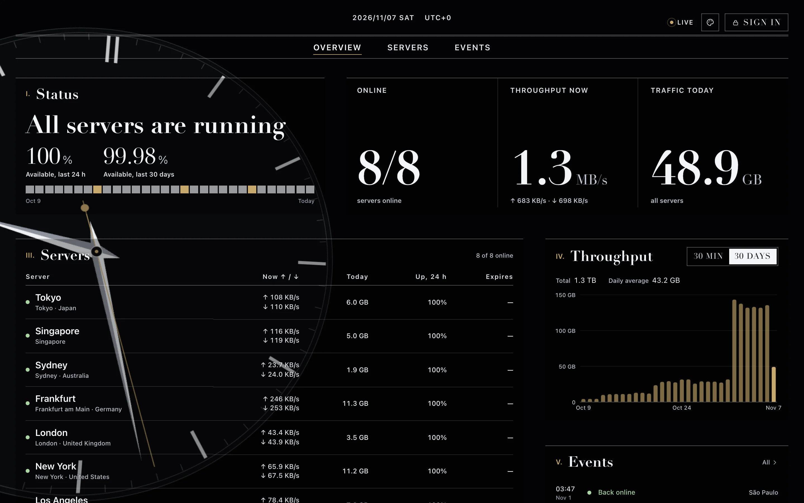

<div align="center">


# Rosélune

**Your own proxy and VPN service, run from one calm panel.**

Add servers, give each person a link, and see everything that happens - for a team, a family or a small company.

[](https://github.com/Dokoyamo-Lisa/Meridian/releases/latest)
[](LICENSE)
[](go.mod)
[](#quick-start)

[**The guide**](https://doc.losantos.space) &nbsp;·&nbsp; [Quick start](#quick-start) &nbsp;·&nbsp; [For your users](https://tutorial.losantos.space) &nbsp;·&nbsp; [Releases](https://github.com/Dokoyamo-Lisa/Meridian/releases)

</div>

<br>

<picture>
  <source media="(prefers-color-scheme: dark)" srcset="docs/img/status-dark.webp">
  
</picture>

<br>

## Why Rosélune

**It never surprises you.** Users, keys and rules change live through each core's own interface. A core restarts only when you press a button that says so, and nothing pauses unless a person pauses it. The one exception is yours to set: a user who runs out of data is off every server until it starts over.

**It only accepts what works.** The forms refuse any combination that would fail, and every protocol lists exactly which apps can use it, computed by the same code that writes their configs. Tests run every combination through sing-box, mihomo and Xray themselves.

**It keeps itself up to date.** Agents follow the panel by themselves, without asking and without disconnecting anyone. Turn on automatic updates and the panel installs new releases at night too, only when they carry Rosélune's signature.

**It shows you the truth.** Traffic is counted exactly once per user, protocol and day. You see each person's speed now, every address they connect from, and where they went.

<br>

<table>
  <tr>
    <td width="50%"></td>
    <td width="50%"></td>
  </tr>
  <tr>
    <td align="center"><b>Monitor</b><br><sub>Who is on, how fast, from where, through what</sub></td>
    <td align="center"><b>Users</b><br><sub>Status, speed now, quota and expiry at a glance</sub></td>
  </tr>
  <tr>
    <td width="50%"></td>
    <td width="50%" align="center"></td>
  </tr>
  <tr>
    <td align="center"><b>Overview</b><br><sub>What needs you, on one page</sub></td>
    <td align="center"><b>Each user's own page</b><br><sub>Data left, devices, link, QR code, one-tap import</sub></td>
  </tr>
</table>

<sub>Every server, person and number in these pictures is made up.</sub>

## What it does

### Run servers without the busywork

- **One command** installs the panel with HTTPS, and one more, copied from the panel, adds each server. The agent then fetches its cores from their official releases and checks them.
- **Bring what you have.** The agent finds Xray, V2Ray, x-ui, 3x-ui, sing-box and Hysteria2 on a server and imports their protocols with the same keys and passwords, so devices keep working.
- **Servers anywhere.** Dynamic DNS with Cloudflare updates, IPv6-only servers, NAT and container hosts, and a relay for servers with a poor route to the panel.
- **Reinstall or start over** a server in one click, every proxy rebuilt with the same ports, keys and links.

### Give people exactly what they should have

- **Links that detect the app**, and for browsers a page with QR codes and one-tap import.
- **Limits per user:** quota, speed, devices, expiry, plans, and whole servers or single protocols.
- **Their own page** with usage per server, protocol and day, and a Telegram bot to ask what they have left.

### Decide where traffic goes

- **Traffic rules:** sites, countries, ports or BitTorrent go directly, through another server, through a provider's proxy, across a load balancer, or nowhere.
- **Proxy pass:** people connect to a nearby server and leave the internet from another.
- **Blocked sites:** write *anthropic.com, google.com* on one protocol, or for one person on the protocols you tick.
- **Country rules:** block countries on every server, and choose who may open the panel.

### See what happens

- **A status page,** as your front page, on its own domain, or private: availability, load, bandwidth and charts over 30 days, with a live globe. Never users, prices or IP addresses unless you say so.
- **Network profiles:** BGP routes, ASN, usage, an IP score and a look at the /24 around each server, with the address itself masked and never sent to anyone.
- **Break-in checks:** every few minutes each agent looks for crypto-miners, unknown ports, accounts and SSH keys, password guessing and changed system files. Each finding has a button that says what it does; nothing runs until you press it and confirm.

<details>
<summary><b>Everything the health checks look for</b></summary>
<br>

Crypto-miners, programs run from temporary folders, ports nobody opened, new accounts and SSH keys, accounts without a password, SSH that lets passwords in, changed sign-in rules (PAM), start-up files, scheduled tasks and services, programs with administrator rights in temporary folders, SSH sign-ins and password guessing, traffic Rosélune does not account for, and Rosélune's own programs changed.

You mark each finding as yours or seen, here or on every server. Where the server can act, a button says how: **stop it** (its program goes into quarantine), **remove this key**, **lock the account**, **turn the service off**, **move the file to quarantine**, **SSH: keys only**, **block the addresses**. Fixes run only from a signed-in browser after a confirmation, never from a token or an assistant. The server checks everything again first, and every step but stopping a process can be undone. A per-server **security mode** can do some of this by itself. See [health checks](docs/health.md).

</details>

### Make it yours

- **Your name and logo** everywhere users look, in the apps too. The rose, the umbrella, confetti, or your own, with a choice of how it moves.
- **Automate it:** a documented REST API with scoped tokens, and an MCP server so AI assistants can answer *"who is sharing their link?"*, asking first before anything disruptive.
- **A Telegram bot:** alerts, a daily report and commands in your chat, and a Mini App for users' pages.
- **Plugins** restyle pages, add pages, routes, MCP tools and timers. They stay off until you agree to what each may do.
- **Shared servers:** a server can serve two more panels besides its own. **PostgreSQL or SQLite,** moved either way with one command.

## Looks

Nine looks, for you and for each visitor to choose: Romance, Umbrella, Postmodernism and Time, and the quiet tones Ice, Celadon, Ink, Paper and Mist. Nothing to install.

<table>
  <tr>
    <td width="33%"></td>
    <td width="33%"></td>
    <td width="33%"></td>
  </tr>
  <tr>
    <td align="center"><b>Umbrella</b><br><sub>A laboratory after hours</sub></td>
    <td align="center"><b>Postmodernism</b><br><sub>Paper, outlines, blocks of colour</sub></td>
    <td align="center"><b>Time</b><br><sub>A great clock, running live behind the page</sub></td>
  </tr>
</table>

## Protocols

| Protocol | Runs on | What you can choose |
| :-- | :-- | :-- |
| **VLESS** | Xray | raw, WebSocket, gRPC, HTTPUpgrade, XHTTP · REALITY, TLS or none · Vision · post-quantum VLESS Encryption · CDN |
| **VMess** | Xray | the same transports · TLS or none · CDN |
| **Trojan** | Xray | the same transports · TLS or REALITY · CDN |
| **Shadowsocks** | Xray | 2022 ciphers and classic AEAD ciphers, TCP and UDP |
| **SOCKS5, HTTP** | Xray | a username and password per user |
| **Hysteria2** | Hysteria | QUIC, port hopping, Salamander obfuscation, bandwidth limits |
| **WireGuard** | Linux kernel | the official apps, destinations logged per device |
| **mieru** | mita | TCP or UDP, one port and process per user |
| **Snell** | snell-server 5 | one port and process per user |
| **AnyTLS** | sing-box | one port and process per user, any certificate |
| **Port forwards** | nftables or realm | TCP and UDP relays with exact byte counts |

**Works with** Clash Verge, FlClash, mihomo, Stash, sing-box, Shadowrocket, Surge, Quantumult X, Hiddify, Loon, v2rayN, v2rayNG, v2Box, NekoBox, Karing and the official WireGuard apps.

<details>
<summary><b>Certificates, addresses and the finer points</b></summary>
<br>

- **Certificates** come from Let's Encrypt, are pasted in, self-signed, or **shared**: kept once and replaced once for every server. A self-signed certificate is pinned in every app that can check it and left out of the others. Certificate checks are never turned off.
- **REALITY** can borrow a well-known site or front your own website on the server. A domain or camouflage site behind Cloudflare is flagged in red before you save.
- **Proxy pass** can go through two servers with a relay in between, or through a provider's proxy imported as an external node. Links, subscriptions and Clash files can be imported as exits; any that would turn certificate checks off or travel unencrypted are refused.
- **Each protocol** can have its own server address, and anything the forms do not offer can be written as configuration code merged on top of the generated one.
- **Users' own servers** (mieru, Snell, AnyTLS) run as an account without any rights that the firewall keeps away from the server itself and from private networks.

See [routing](docs/routing.md), [IPv6 and dynamic DNS](docs/ipv6-and-dynamic-dns.md) and [how the formats are tested](test/formats/README.md).

</details>

## Quick start

You need a Linux server (amd64 or arm64, systemd) and a domain pointing to it.

**1. Install the panel.** This downloads the newest release, checks its SHA-256 and installs it:

```bash
curl -fsSLO https://raw.githubusercontent.com/Dokoyamo-Lisa/Meridian/main/skills/meridian-deploy/scripts/install-panel.sh
sudo bash install-panel.sh --domain panel.example.com
```

It prints your first sign-in. Change the password, then add a passkey or two-factor sign-in (Settings › Security).

**2. Add a server.** Servers › Add server, then paste the command it shows on that server as root.

**3. Add a protocol.** Protocols › Add protocol. VLESS with REALITY suits most people and needs no domain. Or choose **Import existing setup**.

**4. Add users.** Users › New user. Each gets a link for their apps and a sign-in for their own page at `https://panel.example.com/me`.

That's it. [The guide](https://doc.losantos.space) walks through every step with pictures, and [getting started](docs/getting-started.md) covers installing by hand.

> [!TIP]
> **Prefer to hand it over?** Codex, Claude Code and other coding agents can install and configure Rosélune: point them at this repository, and [AGENTS.md](AGENTS.md) sends them to the step-by-step [deploy skill](skills/meridian-deploy/SKILL.md).

## Documentation

| For | Read |
| :-- | :-- |
| **Getting going** | [The guide](https://doc.losantos.space) · [Getting started](docs/getting-started.md) |
| **Your users** | [The apps tutorial](https://tutorial.losantos.space), in English and Chinese |
| **Running it** | [Operations](docs/operations.md) · [Routing](docs/routing.md) · [IPv6 and dynamic DNS](docs/ipv6-and-dynamic-dns.md) · [Health checks](docs/health.md) · [Telegram bot](docs/telegram.md) |
| **Building on it** | [API](docs/api.md) · [OpenAPI](docs/openapi.json) · [MCP](docs/mcp.md) · [Plugins](docs/plugins.md) |
| **Understanding it** | [Architecture](docs/architecture.md) · [Security](SECURITY.md) · [Changelog](CHANGELOG.md) |

<details>
<summary><b>Building from source</b></summary>
<br>

Go 1.26 or newer (it fetches the toolchain `go.mod` names) and Node 22+.

```bash
make            # UI, panel (dist/meridian) and agents (dist/meridian-agent-linux-*)
make test       # Go tests with the race detector, UI type check and UI tests
make check      # test + vet + staticcheck + govulncheck + npm audit
make release    # dist/release: tarballs and CLI builds for linux/amd64 and linux/arm64, SHA256SUMS(.sig)
make dev        # panel on 127.0.0.1:18080 and the UI dev server on :5173
```

```
cmd/meridian          panel binary (serve, backup, reset-password, reset-site-access, mcp bridge, openapi)
cmd/meridian-agent    agent binary (install, run, uninstall)
internal/panel        HTTP API, auth, compiler (desired state per server), status page, MCP, OpenAPI
internal/agent        agent: Xray / Hysteria / WireGuard / realm / nftables engines, ACME, import scan
internal/subgen       subscription formats and app support
internal/geo          IP locations and country lists (DB-IP Lite)
internal/seal         agent channel crypto (HMAC-signed requests, AES-GCM sealed bodies)
internal/proto        the panel <-> agent contract
web/                  the panel UI and the status page (Preact + Vite), embedded into the panel binary
deploy/               panel installer
demo/                 a made-up fleet for a read-only demo panel
examples/plugins/     example plugins: a theme and a server plugin written in Go
skills/               agent skills: meridian-deploy (install and configure), meridian-admin (operate through MCP)
test/e2e/             end-to-end test kit for a local VM
```

</details>

<br>

---

<sub>

**Rosélune** was called Meridian until 1.3. Its programs, services and paths keep the old name (`meridian`, `meridian-agent`, `/var/lib/meridian`), and so does this repository, so nothing changes on your servers.

**License.** Free software under the [GNU Affero General Public License v3.0](LICENSE): use, study, change and share it. If you run a changed version as a service, its users are entitled to its source.

**Credits.** IP geolocation by [DB-IP](https://db-ip.com) (CC BY 4.0). Map data from [Natural Earth](https://www.naturalearthdata.com) (public domain). Proxy cores: [Xray](https://github.com/XTLS/Xray-core), [Hysteria](https://github.com/apernet/hysteria), [sing-box](https://github.com/SagerNet/sing-box), [mieru](https://github.com/enfein/mieru), [realm](https://github.com/zhboner/realm), and the Linux kernel's WireGuard and nftables.

</sub>
