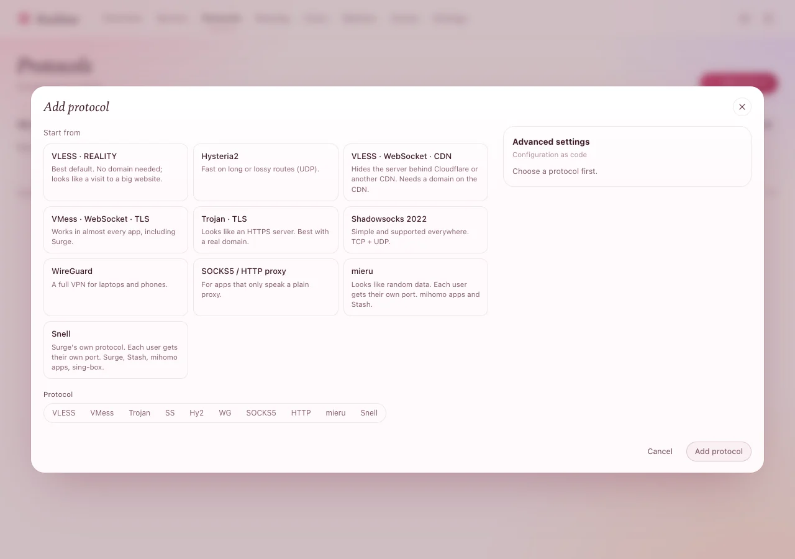
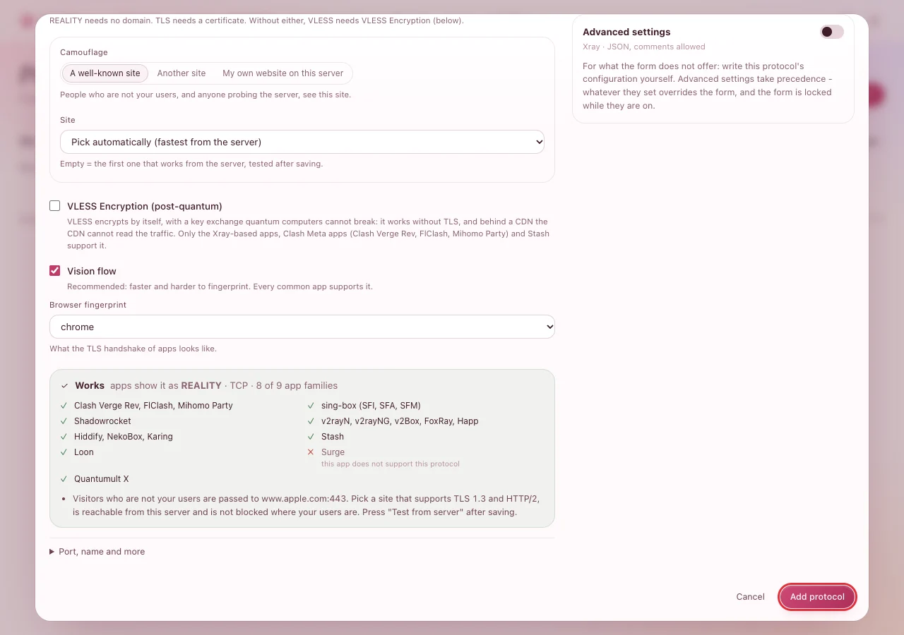
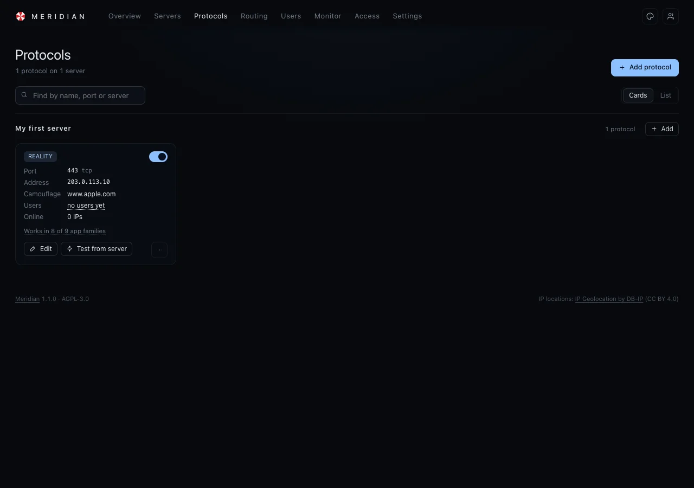

# Add a protocol

Two minutes. A protocol is what people's apps connect to on a server - think of it as the door. For
almost everyone, one door is enough: **VLESS · REALITY**. It needs no domain name, and to anyone
watching it looks like a visit to a big, well-known website.

You need: a server that shows **Online** (see [Add a server](add-a-server.md)).

## 1. Open the form

On the server's page, press **Add a protocol**. (Or: **Protocols** in the top menu, then **Add
protocol**, and pick the server.)

**You should see** the **Add protocol** window with a list called **Start from**.

## 2. Choose VLESS · REALITY

Click **VLESS · REALITY** - *Best default. No domain needed*. The form fills itself in; leave
everything as it is:

- **Port**: empty - the panel picks a free one (it says which: *Empty = a free one of 443, 8443, ...*).
  Type a number if your provider only lets certain ports through.
- **Name**: empty - apps then show the server's name and the protocol (the box shows what, in grey).
- **Camouflage**: *A well-known site*, **Site**: *Pick automatically (fastest from the server)*.
- **Vision flow**: ticked.

Port and name are always right under the choice of protocol. On a server with more than one usable
IP address, **Server address** is there too: **All of the server's addresses** (the default), or one
address for this protocol alone - see [Servers in special places](special-servers.md#several-ip-addresses).

At the bottom, the green **Works** box lists the apps that can use this protocol. For REALITY that is
every common app except Surge.

## 3. Save it

Press **Add protocol**. The panel sends it to the server right away - nothing restarts, nobody is
disconnected.

**You should see** the **Protocols** page with a card for the new protocol: **REALITY**, port
**443 tcp**, the camouflage site, and *Works in 8 of 9 app families*.

### A red box: *Behind Cloudflare - a risk of abuse*

As you fill in the form, the panel looks up the domains the protocol depends on. It shows this red
box when one of them is behind Cloudflare:

- a REALITY **camouflage site** on Cloudflare - Cloudflare can take the server for an abusive proxy;
- a **domain** for TLS, Hysteria2 or AnyTLS pointed at Cloudflare's proxy (the orange cloud) - apps
  would reach Cloudflare, not your server;
- an **address override** (or the server's address) proxied by Cloudflare - the protocol would not work;
- a **CDN domain** on Cloudflare (**VLESS · WebSocket · CDN**) - it works, but Cloudflare can take
  proxy traffic for abuse and suspend the domain or the account.

The box says what to do - usually: pick another camouflage site, or set the record to **DNS only**
(the grey cloud) in Cloudflare. You can still save: **Add protocol** then asks once more, in red, and
**Save anyway** saves it.

## 4. Open the port at your provider

If your provider has a firewall in its own control panel ("security group"), allow incoming **TCP
443** to this server there - that is the port on the card. Without it, apps cannot connect even
though everything here looks fine.

> **Tip:** Press **Test from server** on the card. The server checks that the camouflage site works
> from where it is. If it does not, press **Edit** and pick another site from the list.

Next: [Add users](add-users.md).

## Other doors, for later

| | When to add it |
|---|---|
| **Hysteria2** | People far away from the server, or on unreliable connections: it is faster there. Uses UDP - open its port as **UDP** at your provider. |
| **WireGuard** | A full VPN for laptops and phones, with the official WireGuard apps. |
| **Shadowsocks 2022** | An app that cannot use the others. |
| **VLESS · WebSocket · CDN** | You want the server hidden behind a CDN. Needs a domain on the CDN. On Cloudflare the panel warns you (see the red box above): keep a second protocol that does not go through it. |
| **VLESS · TLS · Vision** | You have a domain that points at this server (DNS only, not proxied): a real certificate from Let's Encrypt, and it looks like an ordinary HTTPS site. |
| **mieru** | People with the mihomo apps (Clash Verge Rev, FlClash, Mihomo Party), Stash or Shadowrocket (2.2.81 and later) who need something that looks like nothing in particular. Each person gets their own port: open the whole range shown on the card, for **TCP** (or **UDP**, if you chose it). |
| **Snell** | People with **Surge** (or Stash, a mihomo app, sing-box). Each person gets their own port: open the range shown on the card, for **TCP and UDP**. |

Each one shows its own **Works** box before you save - the panel refuses any combination that would
not work. [Setup in detail](../../docs/getting-started.md) explains every option.

## The same protocol on your other servers

On the protocol's card, **⋯** › **Copy to other servers…**:

1. Tick the servers.
2. Press **Copy to N servers**.

**You should see** one line per server: *added on port 443*, or another port when 443 is taken there,
or why it could not be added. Each copy has keys of its own; people's links get an entry for each.
Its name, own address, address override and proxy pass are not copied. A protocol with its own
domain works on another server only where that domain points at that server too - the window says so.

## If something goes wrong

| What you see | What to do |
|---|---|
| The form refuses to save and says a port is in use | Another program on the server uses that port. Type another **Port** (right under the protocol), then open that one at your provider. |
| A red box *Behind Cloudflare* that you did not expect | The domain resolves to Cloudflare from the panel. In Cloudflare's DNS, set the record to **DNS only** (grey cloud), or choose another site. |
| **Test from server** fails | The camouflage site does not answer from this server. **Edit** the protocol and pick another site. |
| The card stays *starting up* for more than a minute | The server is downloading Xray for the first time. If it stays, open the server's page: its **Health** and the events say why. |
| Apps cannot connect later | See [Check that it works](check-it-works.md) - most often the provider's firewall (step 4). |
